<p align="center">
  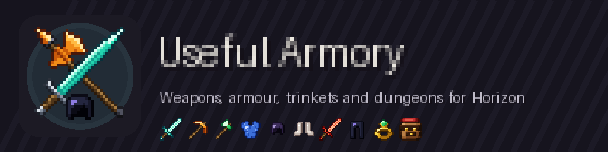
</p>

<p align="center">
  <b>Weapons, armour, trinkets and dungeons for <a href="https://github.com/horizon-rust/horizon">Horizon</a>, the Rust rewrite of Minecraft: Java Edition.</b><br>
  Useful Armory started as a Forge 1.12.2 mod I made as a kid. This is it rebuilt and expanded.
</p>

<p align="center">
  
  
  
  
</p>

<p align="center">
  <a href="../../releases">Releases</a> ·
  <a href="docs/items.md">Every item and its stats</a> ·
  <a href="docs/ROADMAP.md">Roadmap</a> ·
  <a href="docs/SCREENSHOTS.md">Screenshots</a> ·
  <a href="../../issues/new/choose">Report a bug</a>
</p>

<p align="center">
  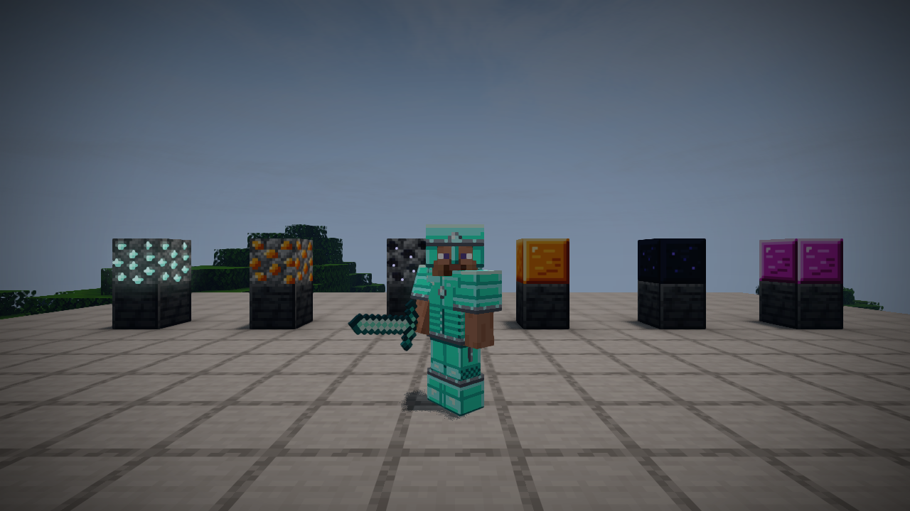
  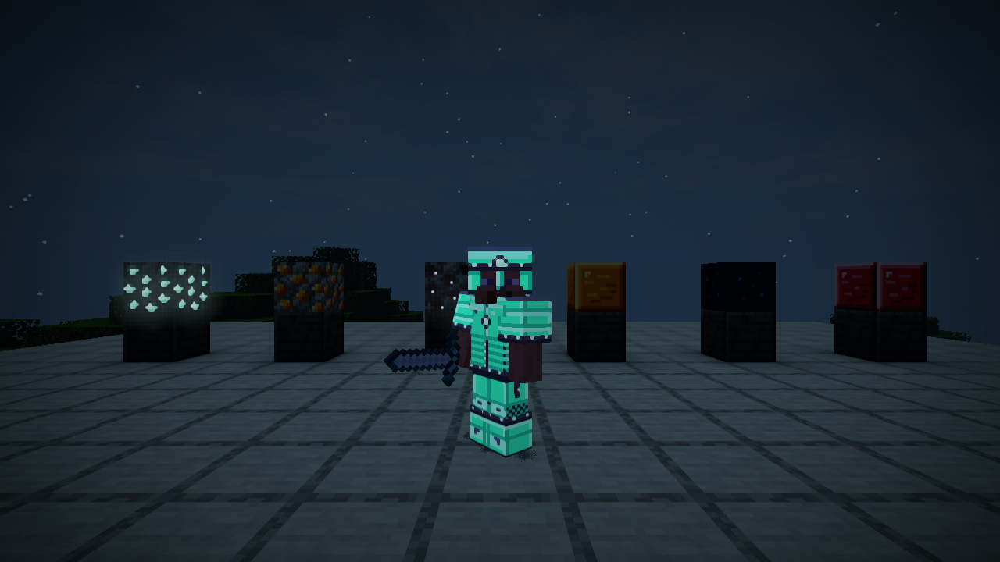
</p>

> **Status:** 0.1.7 is being built on `main` and has not been play-tested yet. The latest published
> release is **0.1.6**. Everything below describes 0.1.7 unless it says otherwise.

**One file, from the mod browser.** Useful Armory is a single `.hmod` with no code in it. What
needs code (the gear light, set bonuses, sneak abilities, weapon effects and the creatures'
looks) comes from the separate library mod [Armory Lib](https://github.com/snipeparparalt2/armory_lib). Without it you still get every
item, block, ore, creature and place. Features that need Armory Lib are marked ★ below.

## What's inside

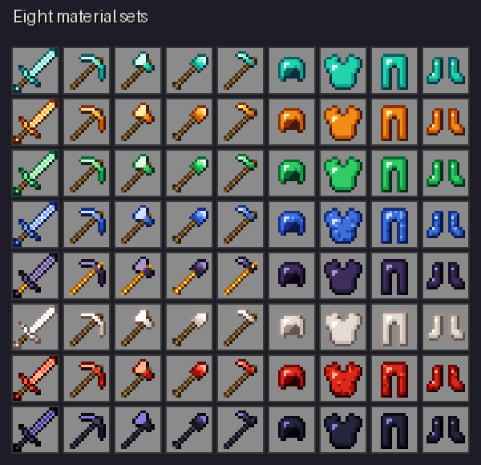

**Eight material sets**: Aquite, Colosifite, Emerald, Lapis, Obsidian, Quartz, Redstone and Shadow.
Each has a sword, pickaxe, axe, shovel, hoe and four armour pieces. On top of those comes the
**Ultimate** set, which cycles through seven colours.

**Full-set bonuses** ★. Wear all four pieces of a set:

| Set | Bonus |
|---|---|
| Aquite | Water breathing and dolphin's grace |
| Colosifite | Fire resistance |
| Emerald | Luck |
| Lapis | +25% experience |
| Obsidian | Half knockback and half explosion damage |
| Quartz | Speed |
| Redstone | Haste |
| Shadow | Night vision |
| Ultimate | Slow regeneration and no fall damage |

**Glowing gear** ★. Glowing items (Aquite, Shadow and a few special weapons) light up the world
around you in their own colour, whether you hold them, wear them or drop them. Aquite and Shadow
armour and ores also have full-bright accents.

<br clear="right">

### Weapons

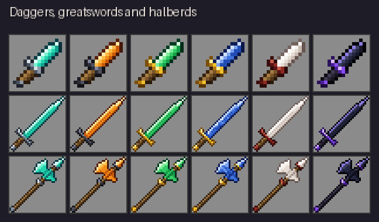

- **Daggers** ★ deal bonus damage when you strike from behind.
- **Greatswords** ★ splash damage onto nearby enemies.
- **Halberds** reach one block further.
- **Unique weapons** ★: the **Magma sword** sets targets on fire, the **Soul eater** heals you on a
  kill, the **Pigman sword** hits piglins harder, **The Nether's legacy** is stronger in the Nether,
  and the **Reaper scythe** makes mobs drop their heads.

<br clear="left">

### Tools that do more (hold sneak) ★

| Ability | Tools |
|---|---|
| Vein mining | Colosifite, Emerald and Shadow pickaxes |
| 3x3 digging | Obsidian pickaxe and shovel |
| Tree felling | Aquite, Emerald and Shadow axes |
| Harvest sweep | The mod's hoes (3x3), the Reaper scythe (5x5) |

With Armory Lib, every ability has its own switch under **Options > Mods > Useful Armory**. Use these switches if
you also run a separate vein-mining or tree-felling mod.

### Places to find

Twelve generated places, with loot in every chest and barrel:

| Place | Where |
|---|---|
| Ruined forge | Forests, plains, meadows |
| Wanderer's camp | Forests, taiga, savanna, plains, desert |
| Aquite shrine | Beaches, rivers, swamps |
| Colosifite watchtower | Hills, savanna, badlands. Guarded by tower sentries |
| Bandit fort | Forests, taiga, savanna, plains, meadows |
| Armory blacksmith | Plains, desert, savanna, snowy and taiga villages |
| Pigman outpost | Nether wastes, just above the lava sea |
| Shadow vault | A mausoleum on the surface, with a spiral stair down to the vault and its guardians |
| Miner's cache | A mine junction under an old headframe; climb down the ladder shaft |
| Forgotten armory | Rare. A buried arsenal under a ruined gatehouse; take the stair down |
| Infested mine | A spider-filled mine under a fallen, web-hung headframe |
| Crypt | A mausoleum entrance leading down into a multi-room dungeon with one treasure room |

Find one with `/locate structure useful_armory:<name>` (it gives the place's corner; the height
shows as `~`, so look around on the ground there), or drop one in front of you with
`/place structure useful_armory:<name>`. Every place now shows on the surface: the underground
ones have an entrance building with a way down. Only newly generated chunks get places. Six **relics**
(cracked soul gem, ancient hilt, forge master's hammer head, shadow shard, tarnished ring, faded map
scrap) turn up in their chests.

### New ores

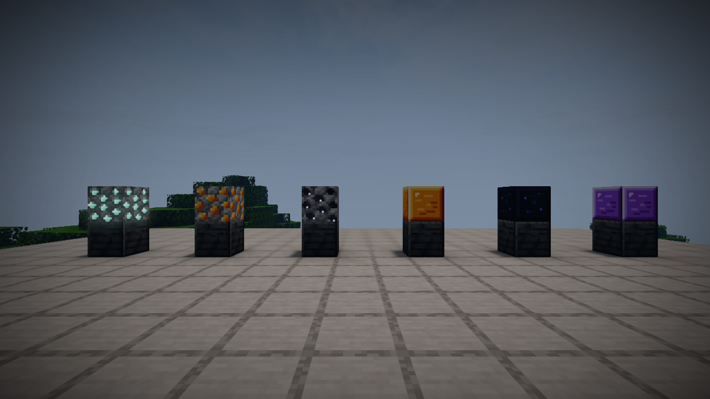

Aquite, Colosifite and Shadow ore generate in stone, and in deepslate further down. The ore
textures hold only the mineral and draw the game's own stone underneath, so they match any resource
pack.

| Ore | Y range | Attempts per chunk | Max vein |
|---|---:|---:|---:|
| Colosifite | -32 to 56 | 10 | 8 |
| Aquite | -16 to 64 | 8 | 7 |
| Shadow | -64 to -8 | 3 | 5 |

<br clear="right">

<p align="center">
  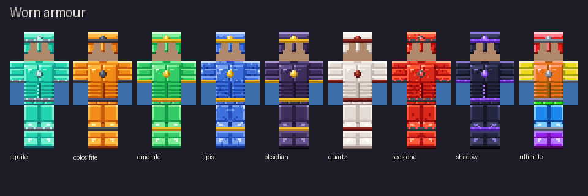
</p>

## Still being built for 0.1.7

0.1.7 ships as one update. These parts are in progress, and the textures for most are already drawn:

- [ ] New mobs: shade, tide lurker, ember brute and lost pigman, plus their own looks for the vault guardian and tower sentry
- [ ] Gold chicken, a tameable shadow hound and the armory golem
- [ ] Trinkets (rings, charms, amulets), backpacks, waystones and the recall charm
- [ ] Soul jar, soul forge upgrades, and charged greatsword and halberd attacks
- [ ] Bosses (forge warden, pigman king, reaper) and the shadow citadel
- [ ] Custom enchantments and armour trims

<p align="center">
  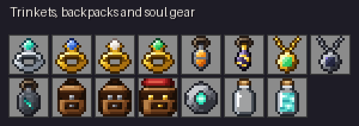
  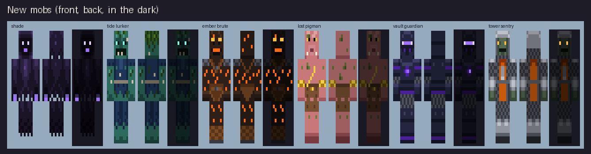
</p>

## Install

You need **Horizon nightly `fdc87ae`** (2026-11-08), which runs game data 26.3.

**From the mod browser:** install Useful Armory, and Armory Lib if you want the extras. That's all.

**By hand:** download `useful_armory-<version>.hmod` from the [releases](../../releases).

1. Open your Horizon game folder. On a default Windows install it is `%APPDATA%\horizon`.
2. Put the `.hmod` in `horizon-mods/` and remove older copies of Useful Armory, including any
   `useful_armory*.hnmod` from earlier test builds in `horizon-native-mods/`.
3. Enable **Useful Armory** in the Mods screen and restart. No Build is needed.

**For the extras ★**, add [Armory Lib](https://github.com/snipeparparalt2/armory_lib/releases): its `armory_lib-<version>.hnmod` goes
in `horizon-native-mods/`, then press **Build** in the launcher. It is a native mod: Rust compiled
into the game and not sandboxed, so only install it from sources you trust. Its whole source is in
its repository. Back up important worlds before changing mods or Horizon versions.

**Getting `missing horizon-native.json`?** The `.hmod` is in `horizon-native-mods/`. Move it to
`horizon-mods/`.

### Check a download

Release files are signed with [minisign](https://jedisct1.github.io/minisign/). Each file has a
`.minisig` beside it, which you can check against the key in `minisign.pub`:

```sh
minisign -Vm useful_armory-<version>.hmod -p minisign.pub
```

## Gallery

<p align="center">
  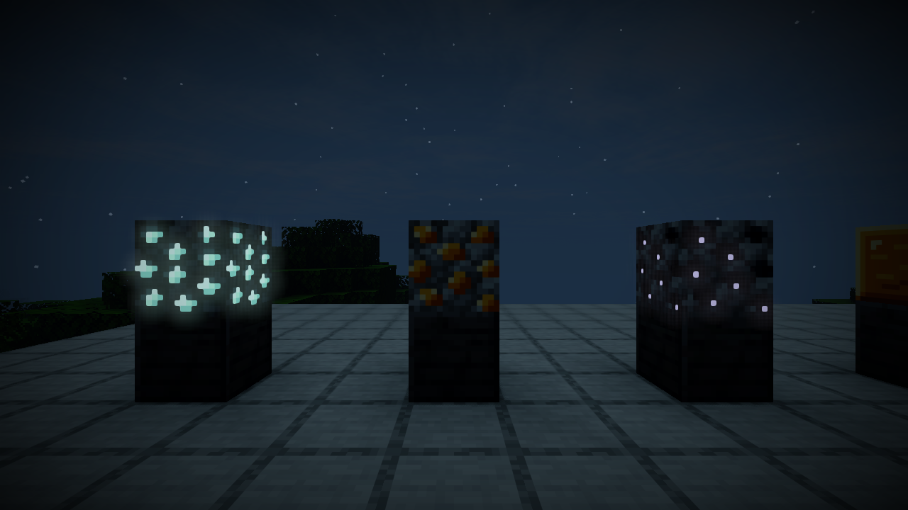<br>
  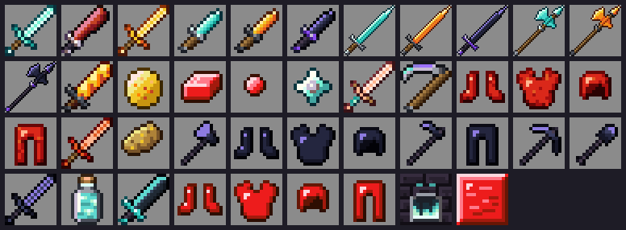<br>
  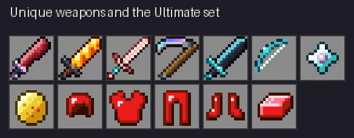
  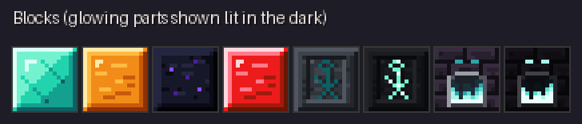
</p>

The four in-game captures were taken on 0.1.5 with the optional Wisdom Horizon shaders, before the
ores moved from cobblestone to stone. The other images are texture renders. New in-game screenshots
will follow the 0.1.7 play-test. See [docs/SCREENSHOTS.md](docs/SCREENSHOTS.md) for captions.

## Build from source

```sh
python3 tools/gen_phase1.py --schema <block_schema.json>   # places, loot, relics, ores, mobs
python3 tools/gen_phase2.py                                # ability tooltips on items
python3 tools/gen_armory_lib.py                            # data/useful_armory/armory_lib.json for Armory Lib
python3 tools/package.py                                   # dist/useful_armory-<version>.hmod
cargo horizon-mod check dist/useful_armory-<version>.hmod  # Horizon's own package check
```

Textures are drawn by script with Pillow: `tools/gen_textures.py` (equipment, blocks, worn armour)
and `tools/gen_new_art.py` (trinkets, backpacks, soul gear, waystone, soul forge, mobs). Both
overwrite their files, so review the changes before committing. Releases are signed as described in
[docs/SIGNING.md](docs/SIGNING.md).

## Releases

Every update gets a GitHub release. Pushing a version tag makes it
(`.github/workflows/release.yml`): the workflow rebuilds the package, checks it against `dist/`
and attaches the `.hmod`, its checksum and, once committed, its signature. Armory Lib has its own
releases in its own repository.

```sh
git tag v0.1.7-pre.1 && git push origin v0.1.7-pre.1   # a pre-release: a build still being tested
git tag v0.1.7 && git push origin v0.1.7               # the full release, after it has been played
```

Only full releases are meant for the Horizon mod browser. A published version never changes: fix
it with a new version number.

## Repository map

- `content/`: everything the content mod loads (textures, models, recipes, loot, places)
- `content/data/useful_armory/armory_lib.json`: what the gear and creatures do, for Armory Lib
  (written by `tools/gen_armory_lib.py`)
- `tools/`: generators, packaging and the item list
- `docs/`: [items](docs/items.md), [roadmap](docs/ROADMAP.md), [validation](docs/VALIDATION.md), [screenshots](docs/SCREENSHOTS.md), [signing](docs/SIGNING.md)
- `dist/`: the latest built packages and their checksums

## Reporting a bug

[Open an issue](../../issues/new/choose) and fill in the template. Include the Horizon revision,
both Useful Armory versions, and `logs/latest.log`. Screenshots help with rendering problems.

## Licence

Everything in this repository, code and art alike, is licensed under the
[Mozilla Public License 2.0](LICENSE). You may play it, share it and reuse its files in your own
projects. If you change any of this mod's files and share the result, those files must stay under
MPL-2.0 with their source available. Minecraft, Horizon and shader content shown in screenshots
belongs to its owners.
