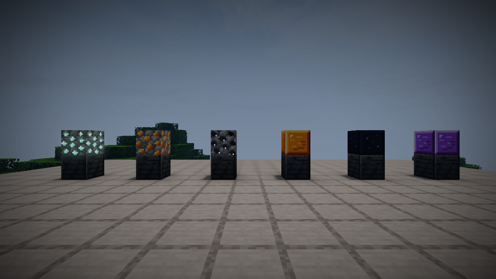
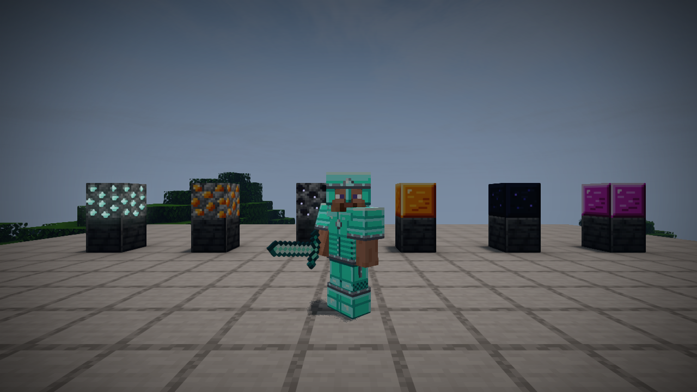
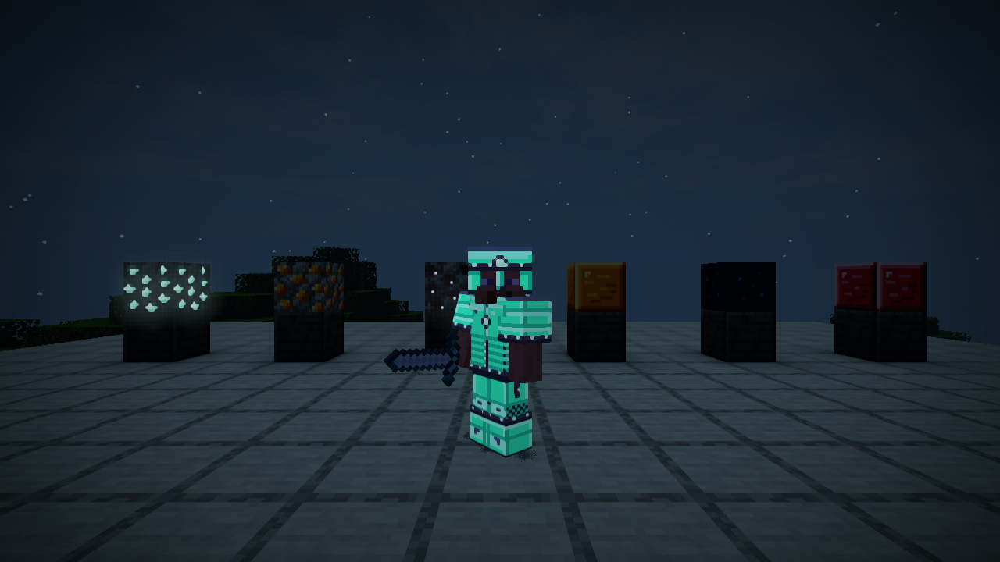
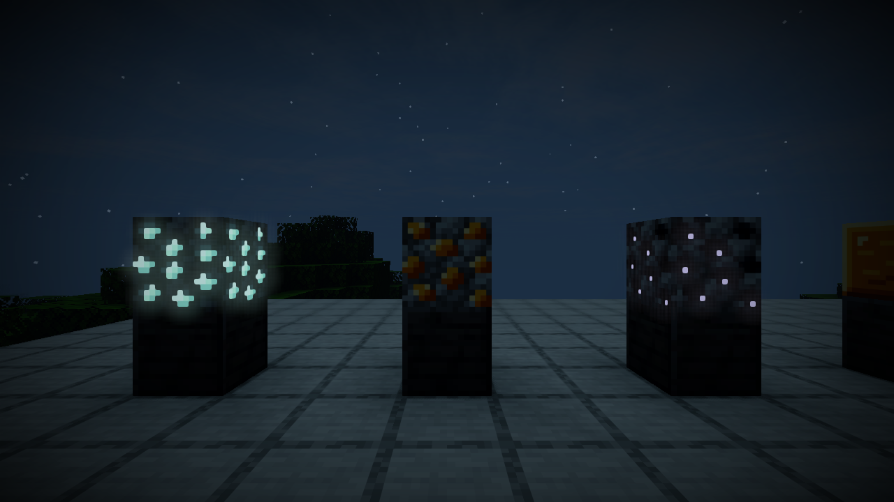

# Mod-page screenshots

Captured in Horizon `fdc87ae` using Useful Armory **0.1.5** and **Wisdom Horizon 1.3.7** shaders. These are unedited in-game PNG captures at 1280×720. The shader is optional and is not included with Useful Armory. The screenshots show the standalone content mod, without the retired native lighting companion.

## Ores and storage blocks

Left to right: Aquite ore, Colosifite ore, Shadow ore, Colosifite block, Shadow block, and Ultimate block. The ore backgrounds match vanilla cobblestone; the colored mineral patterns retain their original artwork. The Ultimate storage block changes color over time.

## Aquite armor in daylight

The complete worn Aquite set and its sword.

## Emissive armor at night

Worn Aquite armor accents stay bright in darkness. The held sword does not receive the emissive effect, and the armor does not cast light onto the surroundings.

## Ore accents at night

Aquite and Shadow mineral accents have emissive masks; Colosifite is shown between them for comparison.

Use the individual PNG files when uploading the mod-page gallery. Useful Armory's own artwork is under the [MPL-2.0](../LICENSE); third-party game and shader content in the captures retains its respective rights.
